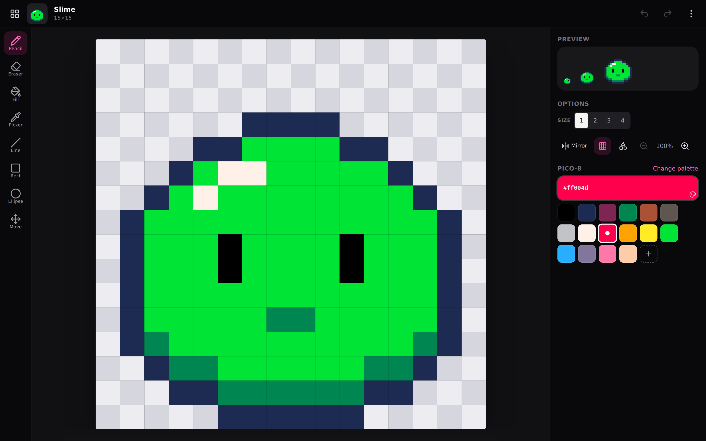
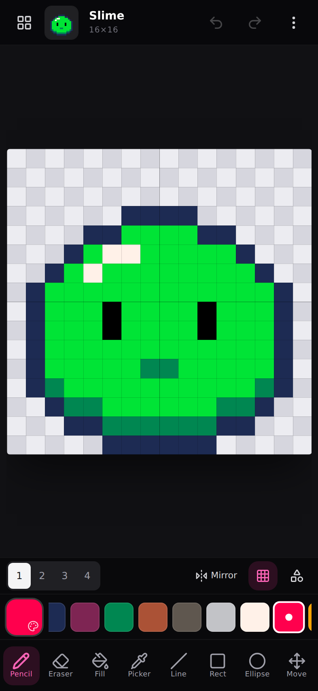

<div align="center">

# Dottle

**A mobile-first pixel art sprite editor, built for the web.**

Draw crisp 16×16 to 32×32 sprites on your phone or your desktop — install it as an app, keep drawing offline.

[**Live Demo →**](#) <sub>_(add your Cloudflare Pages URL here after deploying — see [Deployment](#deployment))_</sub>

[](#deployment)
[](LICENSE)
[](#installing-as-an-app)

[](https://react.dev/)
[](https://www.typescriptlang.org/)
[](https://vite.dev/)
[](https://tailwindcss.com/)

<br>



</div>

## Contents

- [Features](#features)
- [Screenshots](#screenshots)
- [Tech stack](#tech-stack)
- [Getting started](#getting-started)
- [Deployment](#deployment)
- [Installing as an app](#installing-as-an-app)
- [Project structure](#project-structure)
- [Data & privacy](#data--privacy)
- [Browser support](#browser-support)
- [License](#license)

## Features

| | |
|---|---|
| **Canvas sizes** | 16×16, 24×24, and 32×32 sprites |
| **Drawing tools** | Pencil, eraser, fill, eyedropper, line, rectangle, ellipse, and move — each with a keyboard shortcut |
| **Brush & symmetry** | Adjustable brush size and horizontal / vertical / both-axis mirror drawing |
| **Shape options** | Filled or outlined rectangles/ellipses, global or contiguous fill |
| **Transform tools** | Flip, rotate, nudge (wrapping shift), center, auto-outline, and clear — all fully undoable |
| **Color palettes** | PICO-8, Sweetie 16, Endesga 32, NA16, Game Boy, and Grayscale, plus custom colors and a recent-colors tray |
| **Sprite gallery** | Create, duplicate, rename, and delete multiple sprites, all persisted locally |
| **Import** | Bring in existing images, automatically resized and quantized to the sprite grid |
| **Export** | Download, share, or copy PNGs at 1×–32× scale with transparent, white, or black backgrounds |
| **Undo/redo** | Full history for every edit and transform |
| **Mobile-tuned UI** | Bottom toolbars, touch-friendly hit targets, pinch-to-zoom canvas, two-finger-tap undo |
| **Installable & offline** | Full PWA — a service worker precaches every asset, so it keeps working with no network connection |

## Screenshots

<table>
<tr>
<td width="65%"></td>
<td width="35%"></td>
</tr>
<tr>
<td align="center"><sub>Desktop — side panels for preview, options, and palette</sub></td>
<td align="center"><sub>Mobile — compact bottom toolbars</sub></td>
</tr>
</table>

## Tech stack

- [React 19](https://react.dev/) + [TypeScript](https://www.typescriptlang.org/)
- [Vite 7](https://vite.dev/) for development and bundling
- [Tailwind CSS 4](https://tailwindcss.com/) for styling
- [vite-plugin-pwa](https://vite-pwa-org.netlify.app/) (Workbox) for the web app manifest and offline service worker
- [lucide-react](https://lucide.dev/) for icons
- [Cloudflare Pages](https://pages.cloudflare.com/) for hosting and deployment

## Getting started

```bash
npm install
npm run dev
```

Open the printed local URL in your browser (or on your phone, on the same network).

> **Note:** the source `index.html` loads unbundled TypeScript modules, so it only runs through the Vite dev server — opening it directly from disk won't work. The service worker is also disabled in dev mode, so offline behavior can only be checked against a production build.

### Building for production

```bash
npm run build
npm run preview
```

`npm run build` writes a standard static site to `dist/` — HTML, JS, CSS, icons, plus the generated `manifest.webmanifest` and `sw.js`. `npm run preview` serves that build locally; hard-refresh once so the service worker installs, then use your browser's dev tools to go offline and confirm the app still loads.

`vite.config.ts` sets `base: "/"` since the app is served from the root of its own domain, not from a repo-name subpath.

### Available scripts

| Command | Description |
|---|---|
| `npm run dev` | Start the Vite dev server with hot reload (no service worker) |
| `npm run build` | Build the static production site, including the PWA manifest and service worker, to `dist/` |
| `npm run preview` | Serve the production build locally to check it before deploying |
| `npm run typecheck` | Run the TypeScript compiler in check-only mode (not run automatically by `build`) |

## Deployment

Dottle is deployed on [Cloudflare Pages](https://pages.cloudflare.com/), which supports private GitHub repos for free.

1. Push this repo to GitHub (already done).
2. On the [Cloudflare dashboard](https://dash.cloudflare.com/), go to **Workers & Pages → Create → Pages → Connect to Git**, then select the repo (grant Cloudflare's GitHub App access to it if prompted — private repos need explicit per-repo access).
3. Set the build configuration (Cloudflare doesn't auto-detect Vite, so fill these in):
   - Framework preset: **None** (or **Vite**, if offered)
   - Build command: `npm run build`
   - Build output directory: `dist`
   - Node version: read from `.node-version` automatically; otherwise set the `NODE_VERSION` env var to `22`
4. Click **Save and Deploy**. You'll get a `<project>.pages.dev` URL immediately; add a custom domain later under the project's **Custom domains** tab if you want one.

No environment variables or serverless functions are needed — this is a fully static, client-only build. Every push to `main` triggers a new production deployment automatically; every other branch and pull request gets its own preview URL.

`public/_headers` sets a `Cache-Control: no-cache` header on `sw.js`, `registerSW.js`, and `manifest.webmanifest` (Vite copies it into `dist/` unchanged) so browsers always revalidate them — without it, a stale cached service worker could hide new deployments from returning visitors.

Prefer the CLI instead? `npm i -g wrangler`, then `wrangler pages deploy dist` from the project root after running `npm run build`.

## Installing as an app

Dottle is an installable Progressive Web App:

| Platform | How |
|---|---|
| **Desktop** (Chrome / Edge) | Click the install icon in the address bar, or menu → *Install Dottle…* |
| **Android** (Chrome) | Menu → *Add to Home screen* / *Install app* |
| **iOS** (Safari) | Share → *Add to Home Screen* |

After the first load, a service worker precaches the app shell and all assets, so subsequent visits — and drawing sessions — work with no network connection at all. New deployments update automatically in the background and take effect the next time the app is opened.

## Project structure

```
src/
├── components/
│   ├── sheets/        # Bottom-sheet dialogs (gallery, export, color, transform, settings, ...)
│   ├── Header.tsx      # Top bar: sprite name, undo/redo, menu
│   ├── Toolbar.tsx      # Drawing tool selector
│   ├── OptionsBar.tsx   # Brush size, mirror, grid, zoom controls
│   ├── PaletteBar.tsx   # Color swatches
│   ├── PixelCanvas.tsx  # The drawing canvas itself
│   └── ui.tsx           # Shared UI primitives (buttons, sheets, thumbnails, toast)
├── lib/
│   ├── image.ts         # Image import/export, canvas rendering, sharing/clipboard
│   ├── palettes.ts      # Built-in color palettes
│   ├── pixels.ts        # Pixel buffer operations (flip, rotate, fill, outline, ...)
│   ├── sample.ts        # Default sample sprite
│   └── storage.ts       # LocalStorage persistence
├── state/
│   └── editor.ts        # Sprite collection + undo/redo reducer
├── types.ts             # Shared type definitions
└── App.tsx              # Application shell and layout
```

## Data & privacy

Dottle runs entirely client-side. Sprites and settings are stored in your browser's `localStorage` — nothing is uploaded to a server. Clearing your browser data will remove your saved sprites.

## Browser support

Any modern evergreen browser (Chrome, Safari, Firefox, Edge) on desktop or mobile. Some export options (native share sheet, clipboard image copy) depend on browser support for the Web Share and Clipboard APIs and will be hidden automatically if unavailable.

## License

Licensed under the [MIT License](LICENSE).
